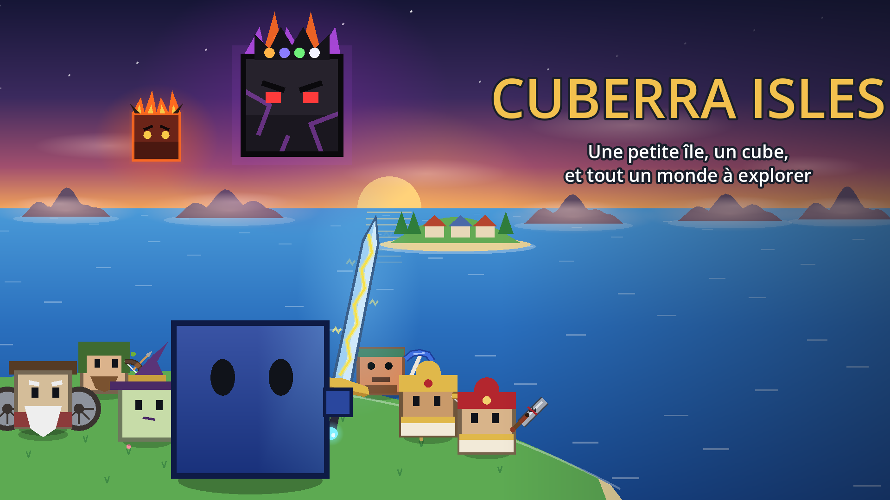

  

<h1 align="center">Cuberra Isles</h1>

<b>Une petite île, un cube, et tout un monde à explorer.</b> 
Un jeu d'aventure en 2D, vu de dessus, où tu es un petit cube.

  🌐 <a href="https://maher-mme.github.io/cuberra-isles/"><b>Le site du jeu</b></a> ·
  <a href="https://github.com/maher-mme/cuberra-isles/releases/latest/download/CuberraIsles.exe"><b>⬇️ Windows</b></a> ·
  <a href="https://github.com/maher-mme/cuberra-isles/releases/latest/download/CuberraIsles.apk"><b>🤖 Android</b></a> ·
  <a href="https://maher-mme.github.io/cuberra-isles/jouer/"><b>▶️ Jouer dans le navigateur</b></a>

---

## 🆕 Quoi de neuf ? (v0.1.4)

- 📱 **Plus fluide sur téléphone et tablette** : le jeu tourne à 30 images par seconde, bien régulières, et le téléphone chauffe beaucoup moins.
- 🩺 **Infos techniques** dans les Options : pour nous aider à comprendre un problème (son, lenteur…).

Avant (v0.1.3) :
- 🤖 **La version Android est là !** Télécharge [CuberraIsles.apk](https://github.com/maher-mme/cuberra-isles/releases/latest/download/CuberraIsles.apk) et installe-la sur ton téléphone.
- 📱↔️ **Le jeu se joue à l'horizontale** sur tous les téléphones et tablettes.

Avant (v0.1.2) :
- ⚡ **Le jeu se charge deux fois plus vite** et utilise bien moins de mémoire.
- 🔊 **Le son marche sur téléphone** dans la version navigateur.
- 🪨 **Des grottes plus vivantes** (v0.1.1) : champignons qui luisent, flaques, cristaux…
- 🖥️ **F11** pour le plein écran, et la même vue quelle que soit la taille de l'écran.

👉 [Toutes les versions et leurs nouveautés](https://github.com/maher-mme/cuberra-isles/releases)

## 🎮 L'histoire

Sur ton île tranquille, le vieil Orban te raconte la légende du **Grand Roi Démon**, enfermé tout au fond du monde il y a très longtemps…
Simple histoire de vieux ? Pourtant, d'étranges choses commencent à arriver sur les îles…
À toi de prendre la mer, d'explorer le monde et de découvrir la vérité !

- 🧭 **Explore** : prends la mer et découvre ce qui se cache au-delà de l'horizon.
- ⚔️ **Deviens plus fort** : fais fabriquer de meilleures armes et de meilleurs outils.
- 🌙 **Méfie-toi de la nuit**, aide les habitants, agrandis ta maison…
- ❓ **Et des secrets** : le reste, c'est à toi de le découvrir !

## ⬇️ Installer et jouer

1. Télécharge **[CuberraIsles.exe](https://github.com/maher-mme/cuberra-isles/releases/latest/download/CuberraIsles.exe)** (Windows 10 ou 11).
2. Double-clique dessus pour jouer. Il n'y a rien à installer.
3. Si Windows affiche **« Windows a protégé votre ordinateur »**, clique sur **« Informations complémentaires »** puis **« Exécuter quand même »**.
   (Ce message apparaît pour tous les petits jeux qui ne sont pas encore connus de Windows.)

🔄 **Les mises à jour sont automatiques** : quand une nouvelle version sort, le jeu la télécharge pendant que tu joues, et l'installe quand tu le fermes. Tes sauvegardes sont gardées.

▶️ **Sans rien installer** : [joue directement dans le navigateur](https://maher-mme.github.io/cuberra-isles/jouer/) (iPhone, iPad, Android, Mac et PC).

🤖 **Sur Android** : télécharge **[CuberraIsles.apk](https://github.com/maher-mme/cuberra-isles/releases/latest/download/CuberraIsles.apk)** et ouvre-le. Si le téléphone le demande, autorise l'installation depuis ton navigateur (avec un contrôle parental, un parent doit l'autoriser). Quand une nouvelle version sort, le jeu te prévient dans le menu.

## ⌨️ Les commandes

### Au clavier

| Touche | Action |
|---|---|
| **ZQSD** ou **flèches** | Se déplacer |
| **Espace** ou **clic** | Frapper / tirer |
| **E** | Parler, ouvrir, entrer, monter en bateau |
| **1 à 9** ou **molette** | Changer d'objet en main |
| **F** | Boire une potion |
| **C** | Plonger |
| **I** | Inventaire, quêtes et carte |
| **Échap** | Pause (et sauvegarde) |
| **F11** | Plein écran |

### Au doigt (téléphone et tablette)

| Commande | Action |
|---|---|
| **Joystick** (pose le pouce à gauche) | Se déplacer |
| **Gros bouton** | Frapper avec l'objet en main |
| **E** (il s'allume quand il y a quelque chose) | Parler, ouvrir, entrer… |
| **Potion**, **vague** | Boire une potion, plonger |
| **Sac**, **pause** (en haut à droite) | Inventaire, pause |
| **Toucher l'écran** | Faire avancer un dialogue |

## 🐛 Tu as trouvé un bug ?

Quelque chose ne marche pas comme prévu ? Dis-le-nous !
Clique sur **« Signaler un bug »** dans le menu du jeu, ou va directement sur
**[la page des bugs](https://github.com/maher-mme/cuberra-isles/issues/new/choose)**.
(Il faut un compte GitHub, c'est gratuit.)

## ✨ Crédits

- **Création, idées et conception** : maher-mme
- **Programmation et dessins** (tout est dessiné par le code) : avec l'aide de Claude (Anthropic)
- **Musiques** (licence [Pixabay](https://pixabay.com/service/license-summary/)) :
  [Osynthw](https://pixabay.com/fr/users/osynthw-50380892/),
  [Lux-aeterna](https://pixabay.com/fr/users/lux-aeterna-49389944/),
  [elijah_k](https://pixabay.com/fr/users/elijah_k-40677025/),
  [marlowemusic](https://pixabay.com/fr/users/marlowemusic-54643571/),
  [hitslab](https://pixabay.com/fr/users/hitslab-47305729/),
  [TheMountain](https://pixabay.com/fr/users/the_mountain-3616498/),
  [epic_musictracks](https://pixabay.com/fr/users/epic_musictracks-27466606/),
  [Sonican](https://pixabay.com/fr/users/sonican-38947841/),
  [nastelbom](https://pixabay.com/fr/users/nastelbom-48128234/),
  [GeoffHarvey](https://pixabay.com/fr/users/geoffharvey-9096471/)
- **Bruitages** : fabriqués par le code du jeu
- **Moteur** : [Godot Engine](https://godotengine.org) (licence MIT)

© maher-mme. Tous droits réservés : le jeu est gratuit, mais merci de ne pas le revendre ni le republier ailleurs.
